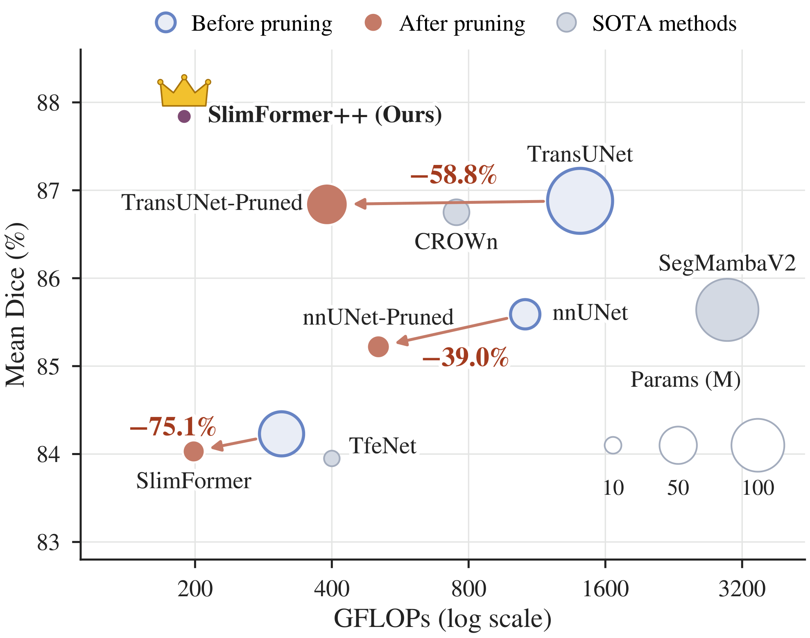
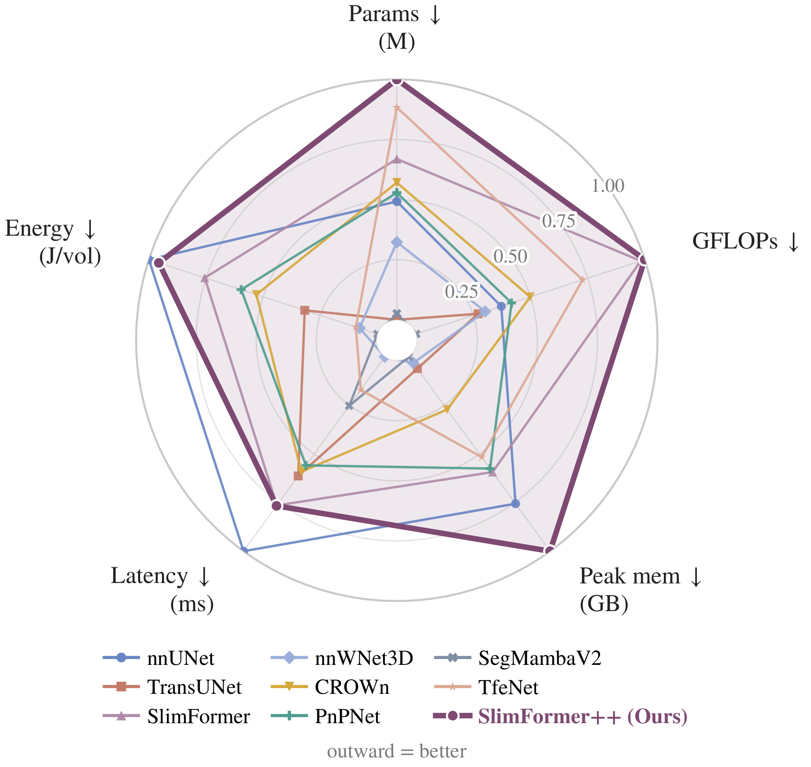

<div align="center">

# SlimFormer++

[![arXiv][arxiv-shield]][arxiv-url]
[![License][license-shield]](LICENSE)

**Token Mixing Where It Matters for Efficient 3D Medical Image Segmentation**

[Paper][arxiv-url] · [Pretrained weights][releases-url] · [Documentation](docs/README.md) · [Reproduction](experiments/README.md)




**5.98M** parameters &nbsp;·&nbsp; **87.84%** mean Dice &nbsp;·&nbsp; **6.50 mm** mean HD95<br />
<sub>Highest mean Dice and lowest mean HD95 with the fewest parameters, against 12 baselines on
eight public CT, MRI and ultrasound datasets (paper, Table III).</sub>

</div>

## Overview

SlimFormer++ is an [nnU-Net v2](https://github.com/MIC-DKFZ/nnUNet) trainer that
keeps token mixing only in the stages where it contributes.

- **Selective Mixing** — windowed Mamba mixing in the first encoder stage;
  deeper stages use residual channel MLPs.
- **Augmented Mixing** — a depthwise convolution at the bottleneck, augmented with
  similarity-weighted sparse long-range context at cost linear in voxel count.
- **Mamba-free implementation** — window attention instead of Mamba, without
  building mamba-ssm or causal-conv1d ([setup](docs/INSTALLATION.md#mamba-free-implementation);
  no pretrained weights).

## Pretrained models

| Dataset | Modality | Dice (%) ↑ | HD95 (mm) ↓ | `predict.sh` key | Weights |
| --- | --- | ---: | ---: | --- | --- |
| ACDC | MRI | 91.56 | 3.70 | `acdc` | [acdc-best-v1][release-acdc] |
| AbdomenCT-1K | CT | 95.62 | 2.84 | `abdomenct1k` | [abdomenct1k-best-v1][release-abdomenct1k] |
| AMOS2022 | CT only | 89.76 | 11.36 | `amos-ct` | [amos2022-ct-best-v1][release-amos] |

<sub>Dice and HD95 are from Table III of the paper. The fold-0 validation results in
the reproduction bundles are separate measurements, not independent test-set results.</sub>

## Quick start

> [!NOTE]
> Requires Linux, an NVIDIA GPU, Python 3.12, Git, a C++ compiler and CUDA Toolkit
> 12.6 with `nvcc`. Mamba and causal-conv1d compile from source (usually 10–20 min).
> Validated on Linux aarch64 with an NVIDIA GH200.

**Install**

```bash
git clone https://github.com/WHHHHHY822/SlimFormerPlusPlus.git && cd SlimFormerPlusPlus
python3.12 -m venv .venv && source .venv/bin/activate

# PyTorch and build tools first, then the compiled requirements
python -m pip install -c tools/constraints.txt torch==2.6.0 torchvision==0.21.0 --index-url https://download.pytorch.org/whl/cu126
python -m pip install -c tools/constraints.txt pip setuptools wheel packaging ninja
python tools/check_environment.py --cuda
MAX_JOBS=4 python -m pip install --no-build-isolation -r requirements.txt
python -m pip check

# Register the trainer and run a smoke test
python tools/install.py
python tools/smoke_test.py --cuda
```

**Predict** — downloads and verifies the checkpoint, then runs `nnUNetv2_predict`
on `*_0000.nii.gz` images ([data preparation](docs/DATASETS.md)):

```bash
export nnUNet_results=/path/to/checkpoints
bash predict.sh acdc /path/to/imagesTs /path/to/predictions   # or abdomenct1k, amos-ct
```

**Train** — on any nnU-Net dataset; replace `2` with your dataset ID
([environment variables](docs/USAGE.md#train-on-your-data)):

```bash
export nnUNet_compile=false
nnUNetv2_plan_and_preprocess -d 2 --verify_dataset_integrity
nnUNetv2_train 2 3d_fullres 0 -tr nnUNetTrainer_SlimFormerPlusPlus
```

**Reproduce** — evaluates a released checkpoint on the published validation cases
and compares the result with the reference metrics:

```bash
python reproduce.py acdc --images /path/to/images --labels /path/to/labels --output /path/to/evaluation
```

More in the guides: [Installation](docs/INSTALLATION.md) ·
[Datasets](docs/DATASETS.md) · [Usage](docs/USAGE.md) ·
[Reproduction](experiments/README.md) · [Validation](docs/VALIDATION.md)

## TODO

- [x] Pretrained checkpoints for ACDC, AbdomenCT-1K and AMOS2022 CT
- [x] Reproduction bundles and GPU benchmarks
- [x] Mamba-free implementation (no pretrained checkpoint)
- [ ] 3D Slicer extension
- [ ] Installation and GPU validation on Linux x86_64
- [ ] Full training reproduction and full-dataset prediction with the public runtime
- [ ] Multi-GPU equivalence checks

Contributions are welcome: please open an [issue][issues-url] before changing the
architecture or training, and follow [CONTRIBUTING.md](CONTRIBUTING.md).

## Citation

Please cite SlimFormer++ together with [nnU-Net](https://github.com/MIC-DKFZ/nnUNet):

```bibtex
@misc{hong2026slimformertokenmixingmatters,
      title={SlimFormer++: Token Mixing Where It Matters for Efficient 3D Medical Image Segmentation},
      author={Yang Hong and Lei Zhang and Zhihong Liu and Jianqing Mo and Xujiong Ye},
      year={2026},
      eprint={2610.25488},
      archivePrefix={arXiv},
      primaryClass={cs.CV},
      url={https://arxiv.org/abs/2610.25488},
}
```

## License and acknowledgments

**Noncommercial research use only.** This is a source-available license, not an
OSI-approved open-source license; see [LICENSE](LICENSE) and [NOTICE.md](NOTICE.md).

Built on [nnU-Net](https://github.com/MIC-DKFZ/nnUNet),
[MedNeXt](https://github.com/MIC-DKFZ/MedNeXt),
[Mamba](https://github.com/state-spaces/mamba) and
[MONAI](https://github.com/Project-MONAI/MONAI). We thank the providers of
[ACDC](https://www.creatis.insa-lyon.fr/Challenge/acdc/),
[AbdomenCT-1K](https://github.com/JunMa11/AbdomenCT-1K) and
[AMOS2022](https://amos22.grand-challenge.org/).
README layout adapted from [Best-README-Template](https://github.com/othneildrew/Best-README-Template).

[arxiv-url]: https://arxiv.org/abs/2610.25488
[arxiv-shield]: https://img.shields.io/badge/arXiv-2610.25488-b31b1b.svg?style=flat-square
[license-shield]: https://img.shields.io/badge/license-noncommercial%20research-orange.svg?style=flat-square
[releases-url]: https://github.com/WHHHHHY822/SlimFormerPlusPlus/releases
[release-acdc]: https://github.com/WHHHHHY822/SlimFormerPlusPlus/releases/tag/acdc-best-v1
[release-abdomenct1k]: https://github.com/WHHHHHY822/SlimFormerPlusPlus/releases/tag/abdomenct1k-best-v1
[release-amos]: https://github.com/WHHHHHY822/SlimFormerPlusPlus/releases/tag/amos2022-ct-best-v1
[issues-url]: https://github.com/WHHHHHY822/SlimFormerPlusPlus/issues
